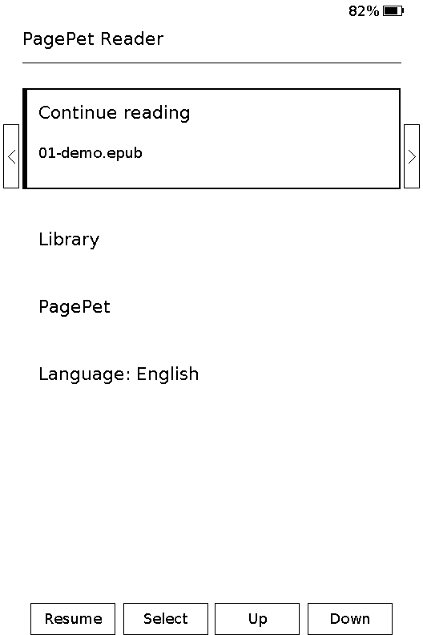
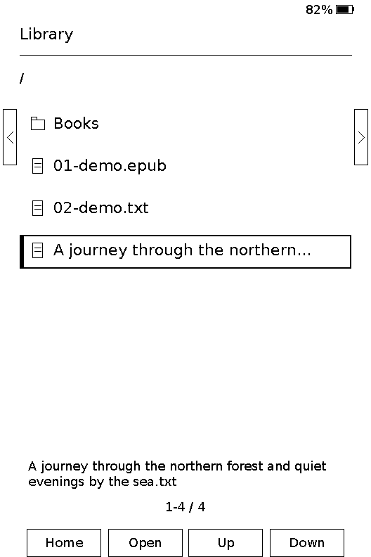
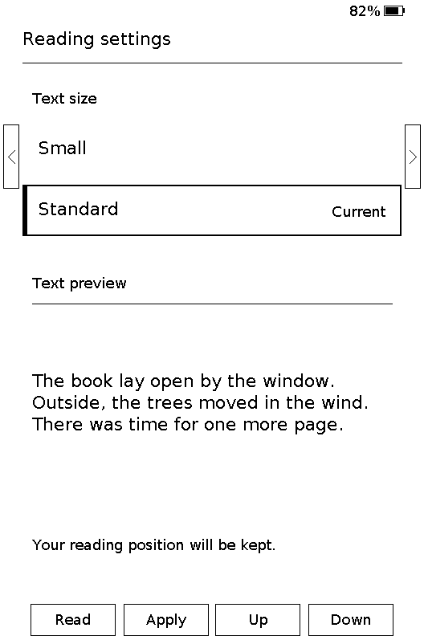

<p align="center">
  
</p>

<h1 align="center">PagePet Reader</h1>

<p align="center"><strong>Open firmware for Xteink X3.</strong> Focused reading, physical buttons, and an optional companion.</p>

<p align="center"><a href="README.ru.md">Русский</a></p>

PagePet Reader is firmware for the **Xteink X3**. The primary experience is returning to a book and reading comfortably with physical buttons. PagePet develops quietly as you read. It never interrupts a page or asks for attention.

## Current state

This is an early development build. It currently provides:

- Local UTF-8 `.txt` and DRM-free, reflowable `.epub` reading from microSD, with pages cached on the card.
- Saved reading position and a visible Resume row for the last book.
- A separate folder-based library, PagePet screen, and English/Russian interface switch, all operated by buttons.
- A monochrome dragon on the optional PagePet screen, drawn from an 8 KB flash-resident sprite without an extra image buffer.
- Two text sizes with a preview before applying; the current position is retained when pages are rebuilt.
- Sleep through the power button.
- Battery icon, percentage and charging marker on every screen, including reading. The X3 gauge is sampled at most every 30 seconds when drawing; no timer refreshes the e-ink just to update battery text. Failed reads keep the last good percentage; before the first good sample, the label is `--%`.
- Contextual front-button labels in four bottom boxes and edge-button hints, following Crosspoint's X3 layout.
- Retry and return-home actions on book, page, and cache errors.

The interface defaults to **English**. To switch to Russian, select **Language: English** on the home screen with Up/Down and press Confirm. The choice is saved on microSD. Select **Язык: Русский** the same way to switch back.

Hardware reading, sleep, recovery, and both known X3 display-controller variants still need device validation. Native EPUB support is experimental; device performance measurements are pending. This build is not a stable daily-use release. See the [development priorities](docs/ROADMAP.md).

The measurement procedure for future hardware runs is in the [X3 benchmark checklist](docs/X3-BENCHMARK.md).

## Interface

Home gives the last book its own reading card. A solid outline and black spine mark the selected row on the monochrome screen. Library repeats the selected filename in a smaller two-line area to help distinguish long titles. Reading settings show both sizes, mark the current one, and preview the selected size before applying it. Back cancels the selection and returns to reading.

<p align="center">
  
  
  
</p>

Screenshots show the actual 528×792 framebuffer from the desktop simulator with sample books; physical e-ink appearance still needs device validation.

## Button controls

| Screen | Controls |
| --- | --- |
| Home | Continue reading, Library, PagePet, and language. Confirm activates the selected row; Back resumes the saved book directly. |
| Library | Up/Down or Left/Right selects a folder/book; Confirm opens it. Back goes to the parent folder, or Home from the card root. |
| Reading | Side buttons or front Left/Right: previous/next page. Confirm: reading settings. Back: return to the book's folder with that book selected. The bottom boxes name each front button's action. |
| PagePet | Back: return Home. |
| Error | Confirm: retry the failed book or page. Back: return Home. |
| Any screen | Power button: sleep. |

Place `.txt` or `.epub` files anywhere in the microSD folder tree, for example `/Books/Author/Book.epub`, then open **Library** from Home. Extensions are case-insensitive. Folders appear first, followed by supported books in the card's directory order; hidden dot-prefixed entries and other file formats are omitted. Only eight rows of the current folder are held in memory, and crossing a list-page boundary scans that folder without indexing the whole tree. There is no 14-book limit. Back restores selection of the folder just exited; returning from reading selects that book in its containing folder.

Continue reading saves the full book path and restores nested books after sleep/restart. Browsing folders adds no state writes to the card. Paths are limited to 127 UTF-8 bytes, including separators; an overlong nested path reports an error instead of opening a truncated path.

EPUB uses the existing FreeInkBook streaming engine. First open creates a container catalog on SD and paginates only the current chapter; later chapters are built when reached. Warm opens reuse that catalog and chapter cache. Ordinary text page turns read cached pages without ZIP decompression or XML parsing, and there is no background whole-book processing. A progress screen appears only when a cache needs building. One very long chapter can still take time on its first open.

Reading positions store the chapter and character offset and survive text-size changes. Existing TXT saves are migrated automatically. Replacing an EPUB at the same path invalidates pages using its ZIP directory, including entry CRCs.

The small-memory profile uses a 112 KiB temporary build buffer, a catalog capped at 64 KiB, and 32 + 20 KiB for the current chapter index and page. Builds also borrow the existing framebuffer; build and reading buffers do not coexist. PNG/JPEG images use a separate temporary 96 KiB budget only on illustrated pages; images exceeding available memory or using unsupported formats may be omitted. XML/image library allocations and system memory are additional to these arena budgets. Oversized catalogs or chapters fail through the retry/Home screen. DRM, embedded fonts, full browser CSS, fixed-layout fidelity, a TOC screen, and button navigation through footnotes are not supported yet. Links and anchors remain in the page cache for future note navigation.

## Build

Git and PlatformIO are required. The hardware SDK and companion engine are pinned as submodules:

```sh
git clone --recurse-submodules git@github.com:7box-studio/pagepet-reader.git
cd pagepet-reader
pio run -e x3
```

Run `./test/host/run.sh` for integration tests using real EPUB parsing, layout, bitmap fonts, page caches and save migration, with simulated SD/display hardware. It requires C/C++ compilers and Python 3. Set `PAGEPET_SANITIZE=1` to enable AddressSanitizer/UBSan when those runtimes are installed. Tests include compressed/stored EPUB, empty chapters, relayout/resume, same-size replacement, large chapters/catalogs, images/links, malformed input, and SD write/read failures.

The firmware uses [FreeInk SDK](https://github.com/Free-Ink/freeink-sdk) for X3 hardware and book layout, and [PagePet](https://github.com/7box-studio/pagepet) for the companion. The two embedded reader sizes are generated from DejaVu Sans; its license is in `licenses/DejaVuSans-LICENSE.txt`.

The pet artwork source is `assets/pagepet-dragon.svg`. After changing it, run `python3 tools/generate_dragon_sprite.py` (requires ImageMagick) and commit the regenerated `include/DragonSprite.h`. Only the 1-bit sprite is compiled into firmware; the color SVG is not loaded on the X3.

## Desktop simulator

On Linux/macOS, run from the repository:

```sh
./tools/simulate.sh
```

Requires `make`, C/C++ compilers and Python 3 with Tk. The first launch builds a native executable; subsequent launches rebuild only changed files. The window runs the actual application in `src/main.cpp`, including menus, PagePet, reading, text settings and saved positions. It displays the real 528×792 portrait framebuffer. Hardware adapters are included only in the computer build and add nothing to the X3 firmware.

Use Up/Down (or Left/Right), Enter and Escape/Backspace as the device buttons. **Power** simulates sleep and wake; **Restart** resets the process and reloads state. The simulator can also disconnect/reconnect the virtual card, advance reading time by 30 seconds for PagePet checks, and export the screen as PNG.

Four front-button controls below the display match the labels on the screen. The battery controls set the simulated percentage and charging state (initially 82%, unplugged); these are test values, independent of the computer's own battery. Battery state survives simulated sleep/restart.

By default, two sample books, nested examples under `Books/`, and persistent simulated card data live in `.cache/simulator/sdcard/`. Add your own `.epub`/`.txt` files there and reopen Library to refresh the list, or select another folder with **Папка microSD…**. To choose the card at launch:

```sh
./tools/simulate.sh --card /absolute/path/to/books
```

The selected folder acts as a writable SD card: caches, reading positions and settings are stored in its `.pagepet/` directory. Use a dedicated copy of your books if you want isolated test data. The simulator does not execute the ESP32 firmware binary, reproduce physical e-ink refresh/ghosting, measure ESP32 heap limits or predict battery life.

For a windowless PNG snapshot, use `./tools/simulate.sh --snapshot /tmp/pagepet-home.png`. Run `python3 tools/simulator/test.py` and `python3 tools/simulator/test_library.py` after building for button-driven application checks (EPUB/TXT, saved settings/positions, sleep/reset, card retry, PagePet, nested folders, long lists and path limits), in addition to the reader integration tests above.

## Community and license

Updates and discussion: [t.me/pagepet_reader](https://t.me/pagepet_reader).

For project rules and contribution guidance, see the [Code of Conduct](CODE_OF_CONDUCT.md), [Contributing guide](CONTRIBUTING.md), and [Security policy](SECURITY.md). Bug reports and focused feature requests use the [issue templates](.github/ISSUE_TEMPLATE/); pull requests use the [pull request template](.github/PULL_REQUEST_TEMPLATE.md).

The firmware source is available under the [MIT license](LICENSE). Dependencies and the font retain their own licenses.
