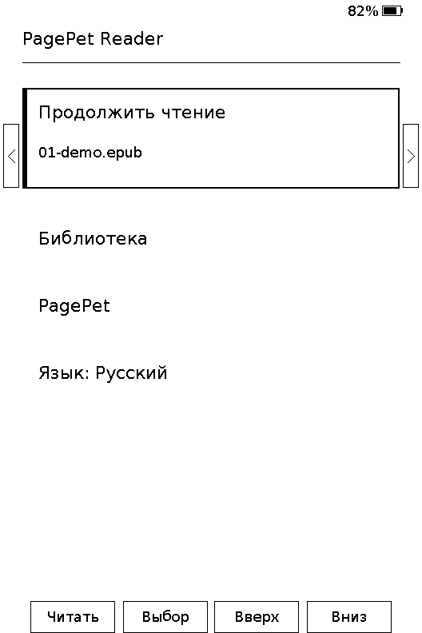
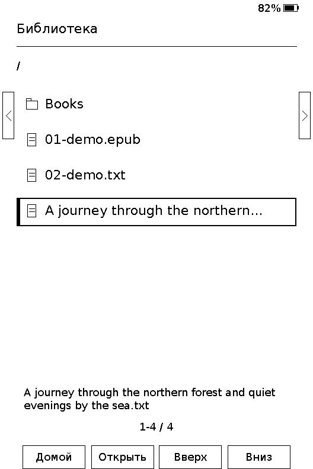
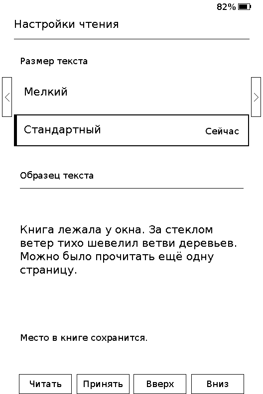

<p align="center">
  
</p>

<h1 align="center">PagePet Reader</h1>

<p align="center"><strong>Открытая прошивка для Xteink X3.</strong> Удобное чтение, управление кнопками и необязательный питомец.</p>

<p align="center"><a href="README.md">English</a></p>

PagePet Reader — прошивка для **Xteink X3**. Её главная задача — помочь быстро вернуться к книге и читать с комфортом, пользуясь физическими кнопками. PagePet развивается по мере чтения, не прерывает страницу и не требует внимания.

## Текущее состояние

Это ранняя версия для разработки. Сейчас доступны:

- Чтение локальных UTF-8 книг `.txt` и EPUB без DRM с обычной потоковой вёрсткой; страницы кэшируются на microSD.
- Сохранение позиции и видимая строка продолжения последней книги.
- Отдельная библиотека с папками, экран PagePet и переключение интерфейса между английским и русским без сенсорного ввода.
- Монохромный дракончик на отдельном экране PagePet: спрайт размером 8 КБ хранится во flash и не требует второго буфера изображения.
- Два размера текста с образцом перед применением; текущая позиция сохраняется при перестроении страниц.
- Сон по кнопке питания.
- Значок батареи, процент и отметка зарядки на всех экранах, включая чтение. Датчик X3 опрашивается при отрисовке не чаще раза в 30 секунд; отдельных обновлений e-ink ради заряда нет. При ошибке остаётся последний известный процент, до первого успешного чтения показывается `--%`.
- Подсказки действий передних кнопок в четырёх рамках снизу и подсказки боковых клавиш по образцу Crosspoint для X3.
- Кнопки повторной попытки и возврата домой при ошибках книги, страницы или кэша.

**Английский** включён по умолчанию. Чтобы выбрать русский, найдите пункт **Language: English** на главном экране кнопками вверх/вниз и нажмите подтверждение. Выбор сохраняется на microSD. Для возврата к английскому таким же образом выберите **Язык: Русский**.

Чтение, сон, восстановление и оба известных варианта контроллера экрана X3 ещё нужно проверить на устройстве. Встроенная поддержка EPUB экспериментальная; замеры на X3 ещё предстоят. Сборка не готова как стабильная прошивка для ежедневного использования. См. [план развития](docs/ROADMAP.ru.md).

Процедура будущих замеров на устройстве описана в [чеклисте X3](docs/X3-BENCHMARK.md).

## Интерфейс

Последняя книга выделена отдельной карточкой на главном экране. Чёрный контур и полоса слева обозначают выбранную строку на монохромном экране. В библиотеке имя выбранного файла повторяется мелким шрифтом в две строки — так проще различать длинные названия. Настройки чтения показывают оба размера, отмечают текущий и дают сравнить образец перед применением. Кнопка «Назад» отменяет выбор и возвращает к чтению.

<p align="center">
  
  
  
</p>

Снимки получены из настоящего буфера 528×792 в настольном симуляторе с пробными книгами. Отображение на физическом e-ink ещё нужно проверить на устройстве.

## Управление кнопками

| Экран | Действия |
| --- | --- |
| Главный | Продолжить чтение, библиотека, PagePet и язык. Подтверждение запускает выбранное действие; Назад сразу открывает последнюю книгу. |
| Библиотека | Вверх/вниз или влево/вправо выбирают папку/книгу; подтверждение открывает её. Назад поднимает в родительскую папку, из корня карты — на главный экран. |
| Чтение | Боковые кнопки или передние влево/вправо: предыдущая/следующая страница. Подтверждение: настройки чтения. Назад: в папку книги с выделением этой книги. Рамки снизу подписывают действие каждой передней кнопки. |
| PagePet | Назад: на главный экран. |
| Ошибка | Подтверждение: повторить открытие книги или страницы. Назад: на главный экран. |
| Любой экран | Кнопка питания: сон. |

Поместите `.txt` или `.epub` в любую папку microSD, например `/Books/Автор/Книга.epub`, и откройте **Библиотеку** с главного экрана. Регистр расширения не важен. Сначала показываются папки, затем книги в порядке записей на карте; скрытые имена с точкой и другие форматы пропускаются. В памяти находятся только восемь строк текущей папки, а при переходе между страницами списка перечитывается эта папка без индексирования всего дерева. Ограничения в 14 книг больше нет. Возврат из подпапки выделяет её в родительской папке, а возврат из чтения — книгу в её каталоге.

Продолжение чтения хранит полный путь и открывает вложенную книгу после сна/перезапуска. Просмотр папок не добавляет записей состояния на SD. Поддерживаются пути до 127 байт UTF-8 вместе с разделителями; слишком длинный вложенный путь вызывает понятную ошибку и не обрезается при открытии.

EPUB читает существующий потоковый движок FreeInkBook. При первом открытии на SD создаётся каталог содержимого и размечается только текущая глава; следующие готовятся по мере чтения. При повторном открытии используются готовый каталог и кэш главы. Обычное перелистывание текстовых страниц читает кэш без распаковки ZIP и разбора XML. Фоновой обработки всей книги нет, экран подготовки появляется только при построении кэша. Очень длинная глава всё ещё может открываться долго в первый раз.

Позиция хранится как «глава + символ» и сохраняется при смене размера текста. Старые сохранения TXT подхватываются автоматически. При замене EPUB под прежним именем кэш страниц обновляется по каталогу ZIP, включая CRC файлов внутри книги.

На время подготовки выделяется буфер 112 КиБ и используется существующий буфер экрана; затем рабочая память освобождается. Каталог ограничен 64 КиБ, индекс текущей главы и страница занимают 32 + 20 КиБ. Для PNG/JPEG временно выделяется до 96 КиБ только на страницах с иллюстрациями; слишком тяжёлые или неподдерживаемые изображения могут пропускаться. Дополнительно память расходуют система и внутренние выделения XML/графических библиотек. Превышение лимитов книги или главы ведёт на экран ошибки с повтором и возвратом домой. DRM, встроенные шрифты, полный CSS браузера, точная фиксированная вёрстка, экран оглавления и переходы по сноскам кнопками пока не поддерживаются. Ссылки и якоря сохраняются в кэше для будущей навигации по примечаниям.

## Сборка

Нужны Git и PlatformIO. SDK и движок питомца закреплены как сабмодули:

```sh
git clone --recurse-submodules git@github.com:7box-studio/pagepet-reader.git
cd pagepet-reader
pio run -e x3
```

Интеграционные проверки: `./test/host/run.sh` (нужны компиляторы C/C++ и Python 3). Проверяется настоящий парсер EPUB, вёрстка, встроенные шрифты, кэш и миграция сохранений; SD-карта и экран моделируются. Сценарии включают сжатые и несжатые EPUB, пустые главы, смену размера и возврат к позиции, замену файла того же размера, большие главы и каталоги, изображения/ссылки, повреждённые файлы и ошибки чтения/записи. При установленных библиотеках санитайзеров `PAGEPET_SANITIZE=1` включает AddressSanitizer/UBSan.

Прошивка использует [FreeInk SDK](https://github.com/Free-Ink/freeink-sdk) для оборудования X3 и разметки книг и [PagePet](https://github.com/7box-studio/pagepet) для питомца. Два встроенных размера текста созданы из DejaVu Sans; его лицензия находится в `licenses/DejaVuSans-LICENSE.txt`.

Исходник рисунка — `assets/pagepet-dragon.svg`. После его изменения запустите `python3 tools/generate_dragon_sprite.py` (нужен ImageMagick) и сохраните обновлённый `include/DragonSprite.h`. В прошивку попадает только однобитный спрайт; цветной SVG на X3 не загружается.

## Симулятор на компьютере

В Linux/macOS запустите из папки проекта:

```sh
./tools/simulate.sh
```

Нужны `make`, компиляторы C/C++ и Python 3 с Tk. При первом запуске собирается компьютерная версия; затем пересобираются только изменённые файлы. В окне работает настоящий код `src/main.cpp`: меню, PagePet, чтение, настройки текста и сохранение позиции. Отображается реальный буфер экрана в портретной ориентации 528×792. Адаптеры оборудования включены только в компьютерную сборку и не увеличивают прошивку X3.

Управление: стрелки вверх/вниз (или влево/вправо), Enter и Escape/Backspace. **Питание** имитирует сон и пробуждение, **Перезапустить** заново запускает процесс и загружает сохранения. Можно извлечь/вставить виртуальную карту, добавить 30 секунд чтения для проверки PagePet и сохранить экран в PNG.

Четыре кнопки под дисплеем соответствуют подписям на экране. В блоке заряда можно задать процент и состояние зарядки: начальные 82% — тестовое значение, не связанное с батареей компьютера. Оно сохраняется при имитации сна и перезапуска.

По умолчанию две пробные книги, вложенные примеры внутри `Books/` и данные виртуальной карты находятся в `.cache/simulator/sdcard/`. Положите туда свои `.epub`/`.txt` и заново откройте библиотеку для обновления списка. Другую папку можно выбрать кнопкой **Папка microSD…** или при запуске:

```sh
./tools/simulate.sh --card /полный/путь/к/книгам
```

Выбранная папка работает как доступная для записи SD-карта: в её каталоге `.pagepet/` сохраняются кэш, позиция чтения и настройки. Для независимых проб используйте отдельную папку с копиями книг. Симулятор не исполняет бинарник ESP32 и не воспроизводит физическое обновление e-ink, остаточные изображения, лимиты памяти ESP32 или расход батареи.

Без графического окна можно получить PNG: `./tools/simulate.sh --snapshot /tmp/pagepet-home.png`. После сборки `python3 tools/simulator/test.py` и `python3 tools/simulator/test_library.py` проверяют приложение кнопками: EPUB/TXT, настройки и сохранения, сон/перезапуск, повтор после ошибки карты, PagePet, вложенные папки, длинные списки и ограничения путей. Это дополняет интеграционные проверки движка чтения, описанные выше.

## Сообщество и лицензия

Новости и обсуждение: [t.me/pagepet_reader](https://t.me/pagepet_reader).

Правила проекта описаны в [Code of Conduct](CODE_OF_CONDUCT.md), [Contributing guide](CONTRIBUTING.md) и [политике безопасности](SECURITY.md). Для сообщений об ошибках и предложений есть [шаблоны issue](.github/ISSUE_TEMPLATE/), а для pull request — [шаблон PR](.github/PULL_REQUEST_TEMPLATE.md).

Исходный код прошивки распространяется по [лицензии MIT](LICENSE). У зависимостей и шрифта свои лицензии.
